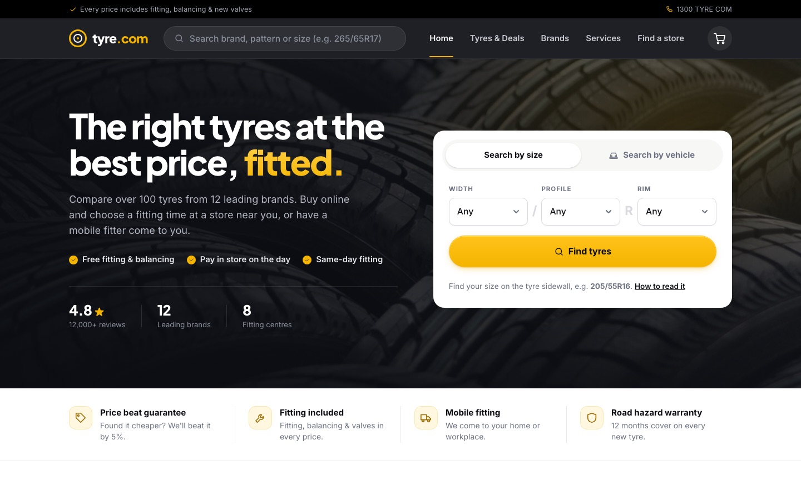
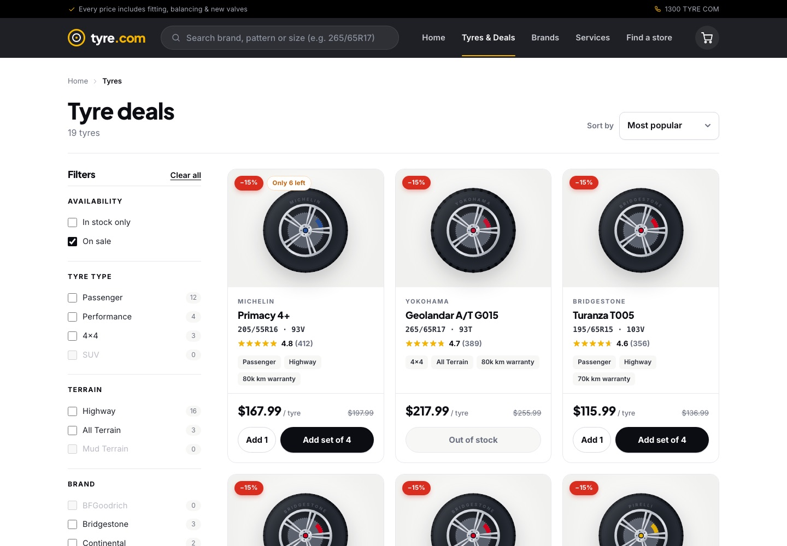
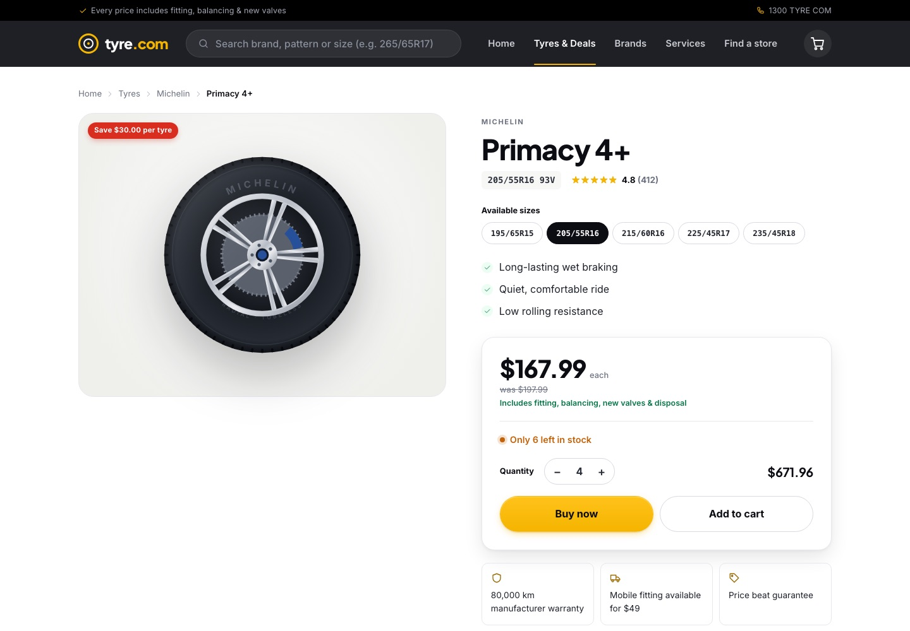
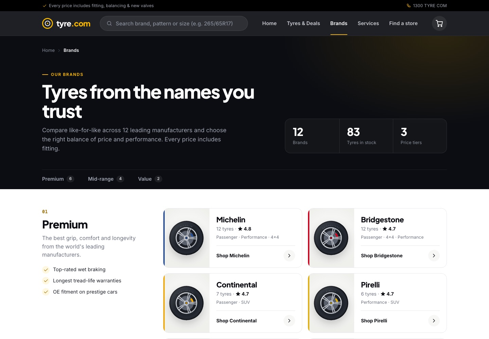
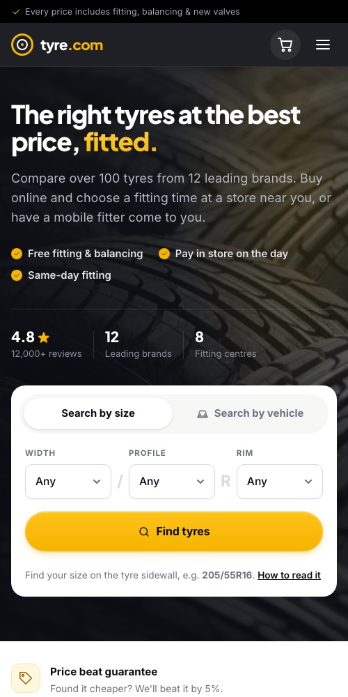

# tyre.com

An online tyre store, built as a demo project for an internship task. Customers can find tyres by size or by vehicle, filter and compare them, add single tyres or sets to a cart, and book a fitting at a store or with a mobile fitter. Car services can be booked too.

**Live demo:** https://tyrecom-mu.vercel.app/

> All products, stores, prices and reviews are sample data. No payment is taken.



| Tyre deals with filters | Product page |
| --- | --- |
|  |  |

| Brands | Mobile |
| --- | --- |
|  |  |

## Tech stack

- **client/**: React 18, Vite, React Router. Plain CSS with design tokens, no UI library. Product images are drawn in SVG, so every tyre has an image without hosting photos.
- **server/**: Express API with a seeded catalogue. Orders, bookings and newsletter sign-ups are saved to a JSON file.
- **Tests**: Node's built-in test runner against the real API.
- **Hosting**: Vercel. The API runs as one serverless function ([api/index.js](api/index.js)) and the client is served as static files.

## Getting started

Requires Node 18+.

```bash
npm run install:all

# in two terminals
npm run dev:server   # API on http://localhost:4000
npm run dev:client   # app on http://localhost:5173 (proxies /api to the server)
```

To run in production mode, where the API also serves the built app:

```bash
npm run build
npm start            # http://localhost:4000
```

Run the API tests with `npm test`.

## Features

| Page | What it does |
| --- | --- |
| Home | Search by size (the width/profile/rim dropdowns narrow to sizes that exist) or by vehicle (make → model → year → factory sizes); deals, categories, brands, FAQ, size guide |
| `/tyres` | Results with filters (type, terrain, brand, price, stock, sale) and sorting. All filter state lives in the URL, so links can be shared. Deals are this page with the "On sale" filter |
| `/tyres/:id` | Product detail: other sizes of the same pattern, quantity, stock level, specs, tyre label, alternatives in the same size |
| `/cart` | Change quantities, remove items, see the estimated total. The cart is saved in `localStorage` |
| `/checkout` | Store or mobile fitting, optional alignment, appointment, contact details. The server prices the order live |
| `/order/:id` | Booking confirmation |
| `/services` | Book one or more services at a store |
| `/stores` | Store finder with state filter and search |
| `/brands` | Brands grouped by price tier, with rating and tyre types per brand |

## Design decisions

- **The server owns prices.** Cart totals, fitting fees and order totals are always calculated from the server catalogue. Prices sent by the browser are ignored, so a customer can't change what they pay.
- **Filter counts are honest.** Each number in the filter sidebar is how many results you'd get by ticking that option, with all your other filters applied. Options with no matches are greyed out, so a filter never leads to an empty page. Ticking a brand doesn't change the other brands' counts, so you can still compare them.
- **Stock is respected everywhere.** Customers can buy one tyre (for example after a puncture) or a set. The cart never holds more than is in stock, and the server checks stock again when the order is placed.
- **Shareable URLs.** Search, filters and sorting are kept in the URL, so the back button works and links can be shared.
- **Order confirmations survive restarts.** On Vercel, saved data is wiped when the serverless function restarts. The browser keeps a copy of each order, so the confirmation page still works if the server has lost it.
- **Accessible by default.** The site uses semantic HTML, labelled form fields, visible keyboard focus and a reduced-motion setting, and it's laid out for phones as well as desktop.

## Tests

`npm test` runs 9 API tests covering:

- size filtering, sorting, and the size dropdowns narrowing as you choose
- vehicle lookup returning the right factory sizes
- order totals calculated on the server, and field-level validation errors
- service booking
- filter counts always matching the results you get, and the brand list matching the catalogue

## Limitations and next steps

This is a demo, so some parts are deliberately simple:

- **Storage.** Data is kept in a JSON file, or in `/tmp` on Vercel, which is temporary. The next step would be a hosted database such as Postgres, which would also keep stock levels consistent.
- **Stock** is held in server memory, so it resets when the server restarts.
- **No online payment.** Customers pay in store. Stripe in test mode would be the natural addition.
- **Sample content.** Product data, reviews and contact details are placeholders.

## API

| Method | Path | Notes |
| --- | --- | --- |
| GET | `/api/tyres` | `width, profile, rim, size, brand, category, terrain, q, minPrice, maxPrice, onSale, inStock, sort`. List filters take comma-separated values. Returns `items`, `total` and filter counts in `facets` |
| GET | `/api/tyres/:id` | Includes `alternatives` and `otherSizes` |
| GET | `/api/sizes` | `width, profile` narrow the options |
| GET | `/api/brands` | Each brand with its total tyres (`count`) and how many are in stock (`inStock`) |
| GET | `/api/stores`, `/api/services`, `/api/config` | |
| GET | `/api/vehicles/makes \| models \| years \| sizes` | |
| POST | `/api/orders/quote` | Prices a cart without saving it |
| POST | `/api/orders` | Validates the order, re-prices it on the server, reserves stock. Returns `422` with `fieldErrors` |
| GET | `/api/orders/:id` | |
| POST | `/api/bookings`, `/api/newsletter` | |
